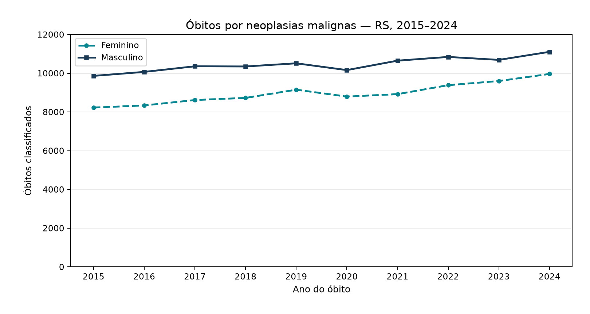
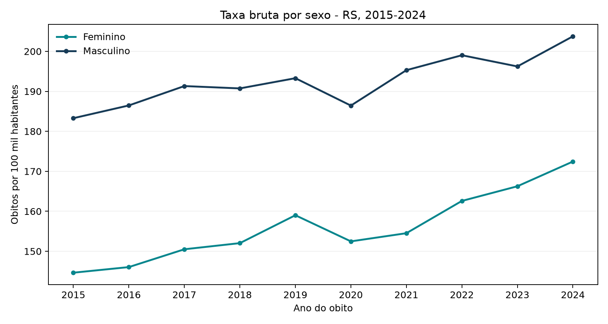
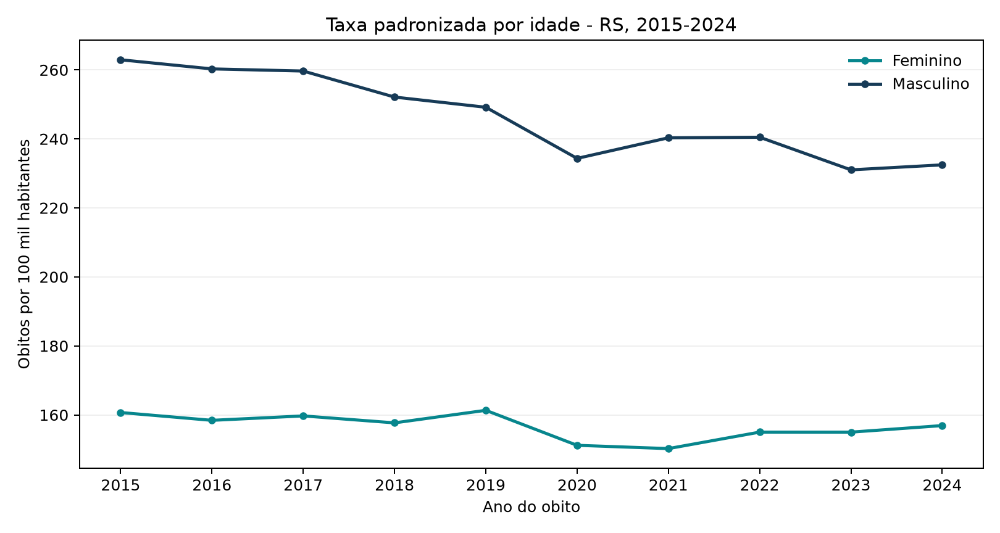

## Objetivo e escopo

Examinar a evolução dos óbitos por neoplasias malignas (causa básica CID-10 C00–C97) entre residentes do Rio Grande do Sul (RS), por sexo e ano do óbito, de 2015 a 2024. Esta é a **Fase 2** do AcessaData-Health.

Os indicadores apresentados utilizam 380 estratos (10 anos × 2 sexos × 19 faixas etárias) previamente auditados no projeto científico original. Dos 194.368 óbitos identificados no período, 194.349 foram classificados nos estratos analíticos; 19 não integraram essas séries. Os totais gerais da pesquisa preservam os 19 registros.

## Métodos

- **Óbitos classificados:** contagem anual por sexo.
- **Taxa bruta:** óbitos classificados divididos pela população estimada do mesmo sexo e ano, multiplicados por 100.000.
- **Taxa padronizada por idade:** método direto, com pesos fixos das 19 faixas etárias da população do RS em 2024, **somando os dois sexos**. Os mesmos pesos são aplicados às taxas específicas por idade de homens e mulheres.

As contagens e taxas desta página são descritivas. A análise inferencial de tendência está documentada separadamente e não consiste em regressão direta das taxas padronizadas.

```{r}
#| label: verificar-fase02
#| include: false

series <- read.csv("dados_publicos/series_anuais_sexo_2015_2024.csv", stringsAsFactors = FALSE)
totais <- read.csv("dados_publicos/conciliacao_anual.csv", stringsAsFactors = FALSE)
pesos <- read.csv("dados_publicos/pesos_padrao_rs_2024.csv", stringsAsFactors = FALSE)

colunas_serie <- c("ano", "sexo", "obitos_classificados", "populacao", "taxa_bruta_100mil", "taxa_padronizada_100mil")
stopifnot(
  all(colunas_serie %in% names(series)),
  nrow(series) == 20,
  !anyDuplicated(series[c("ano", "sexo")]),
  setequal(series$ano, 2015:2024),
  setequal(series$sexo, c("Feminino", "Masculino")),
  all(table(series$ano) == 2),
  all(table(series$sexo) == 10),
  all(is.finite(series$populacao)),
  all(series$populacao > 0),
  all(is.finite(series$obitos_classificados)),
  all(series$obitos_classificados >= 0),
  all(is.finite(series$taxa_bruta_100mil)),
  all(is.finite(series$taxa_padronizada_100mil)),
  nrow(totais) == 10,
  all(c("ano", "total", "classificados", "diferenca") %in% names(totais)),
  nrow(pesos) == 19
)

bruta_recalculada <- 1e5 * series$obitos_classificados / series$populacao
stopifnot(max(abs(bruta_recalculada - series$taxa_bruta_100mil)) < 1e-6)

soma_ano <- aggregate(obitos_classificados ~ ano, data = series, FUN = sum)
conferencia <- merge(soma_ano, totais[c("ano", "classificados")], by = "ano")
stopifnot(
  nrow(conferencia) == 10,
  all(conferencia$obitos_classificados == conferencia$classificados),
  all(totais$total - totais$classificados == totais$diferenca),
  sum(series$obitos_classificados) == 194349,
  sum(totais$total) == 194368,
  sum(totais$diferenca) == 19
)
```

::: {.callout-note title="Escopo da verificação pública"}
O código incorporado recalcula as **taxas brutas** e reconcilia os totais usando CSVs agregados públicos. As **taxas padronizadas** foram recalculadas e confrontadas independentemente em R e Python no projeto científico original, que contém os 380 estratos necessários; esta página não reprocessa esses microdados nem reestima os modelos de tendência. A verificação de 19 linhas de pesos corresponde à estrutura publicada, não substituindo a validação dos valores dos pesos contra a população original.
:::

## 1. Óbitos classificados por sexo

{width="100%" fig-align="center" fig-alt="Gráfico de linhas de 2015 a 2024. Os óbitos classificados masculinos permanecem acima dos femininos em todos os anos. Ambas as séries terminam acima de seus valores de 2015. A escala vertical começa em zero."}

**Fonte e escopo:** SIM / Ministério da Saúde; CID-10 C00–C97; residentes do RS. Os 19 registros não classificados não integram as séries estratificadas.


Os números absolutos aumentaram entre 2015 e 2024 em ambos os sexos. Contagens absolutas não mensuram, isoladamente, a evolução do risco populacional.

## 2. Taxas brutas

{width="100%" fig-align="center" fig-alt="Gráfico de linhas de taxas brutas por 100 mil habitantes, de 2015 a 2024. As séries masculina e feminina apresentam valores mais altos em 2024 do que em 2015."}

As taxas brutas consideram o tamanho da população, mas não controlam sua composição etária. A comparação entre os anos extremos mostra aumento das taxas brutas nos dois sexos.

## 3. Taxas padronizadas por idade

{width="100%" fig-align="center" fig-alt="Gráfico de linhas das taxas padronizadas por idade, de 2015 a 2024. A série masculina apresenta queda expressiva no período, enquanto a feminina oscila em faixa mais estreita e termina ligeiramente abaixo do valor inicial."}

Aplicando uma mesma estrutura etária de referência (RS, 2024, ambos os sexos), ambas as séries apresentam valores menores em 2024 do que em 2015, com redução mais intensa no masculino. Esse contraste com as taxas brutas é compatível com influência da composição etária, mas **não quantifica isoladamente o efeito do envelhecimento**.

## 4. Comparação descritiva: 2015 e 2024

```{r}
#| label: tbl-comparacao-fase02
#| tbl-cap: "Indicadores em 2015 e 2024 e variação percentual relativa entre os extremos"

inicio <- series[series$ano == 2015, ]
fim <- series[series$ano == 2024, ]
comp <- merge(inicio, fim, by = "sexo", suffixes = c("_2015", "_2024"))
var_pct <- function(x0, x1) 100 * (x1 / x0 - 1)

resumo <- data.frame(
  Sexo = comp$sexo,
  `Óbitos 2015` = comp$obitos_classificados_2015,
  `Óbitos 2024` = comp$obitos_classificados_2024,
  `Variação dos óbitos (%)` = round(var_pct(comp$obitos_classificados_2015, comp$obitos_classificados_2024), 2),
  `Variação da taxa bruta (%)` = round(var_pct(comp$taxa_bruta_100mil_2015, comp$taxa_bruta_100mil_2024), 2),
  `Variação da taxa padronizada (%)` = round(var_pct(comp$taxa_padronizada_100mil_2015, comp$taxa_padronizada_100mil_2024), 2),
  check.names = FALSE
)
knitr::kable(resumo, format = "html", digits = 2)
```

As variações percentuais apresentadas comparam apenas os anos extremos; **não** representam a variação percentual anual estimada (APC) pela regressão.

## 5. Tendência ajustada e incerteza

Os modelos de Poisson previamente auditados, ajustados por faixa etária com *offset* populacional, estimaram:

| Sexo | APC anual, modelo linear | IC95% CR2/Satterthwaite |
|---|---:|---:|
| Feminino | −0,4144% | −0,8788% a +0,0522% |
| Masculino | −1,6318% | −1,9945% a −1,2677% |

Na especificação linear com CR2, o intervalo masculino permaneceu abaixo de zero; o feminino incluiu zero. Assim, **não se confirmou tendência estatisticamente diferente de zero no feminino ao nível bilateral de 5% sob essa especificação**. Os coeficientes e intervalos foram transcritos de auditorias anteriores, não recalculados nesta página.

## 6. Limitações

- A série reúne apenas dez anos; a correção CR2 não elimina automaticamente dependência serial.
- As oscilações de 2020 e 2021 não sustentam inferências causais.
- Os 19 óbitos sem classificação completa estão nos totais gerais, mas não nos indicadores estratificados por sexo/idade.
- As taxas padronizadas usam uma **população-padrão interna** (RS em 2024), não um padrão mundial.
- A ordem física dos campos nos CSVs sem cabeçalho de 2022 e 2023 ainda não foi certificada documentalmente.
- As séries agregadas publicadas não permitem refazer, por si só, toda a padronização ou a estimação dos modelos originais.

**Estado:** resultados descritivos reproduzidos em R e Python no escopo testado; interpretação científica preliminar.

## Fontes

- [Sistema de Informações sobre Mortalidade (SIM) — Ministério da Saúde](https://dadosabertos.saude.gov.br/dataset/sim)
- [DATASUS — Mortalidade pela CID-10](https://datasus.saude.gov.br/mortalidade-desde-1996-pela-cid-10/)
- [IBGE — Projeções da População](https://www.ibge.gov.br/estatisticas/sociais/populacao/9109-projecao-da-populacao.html)
